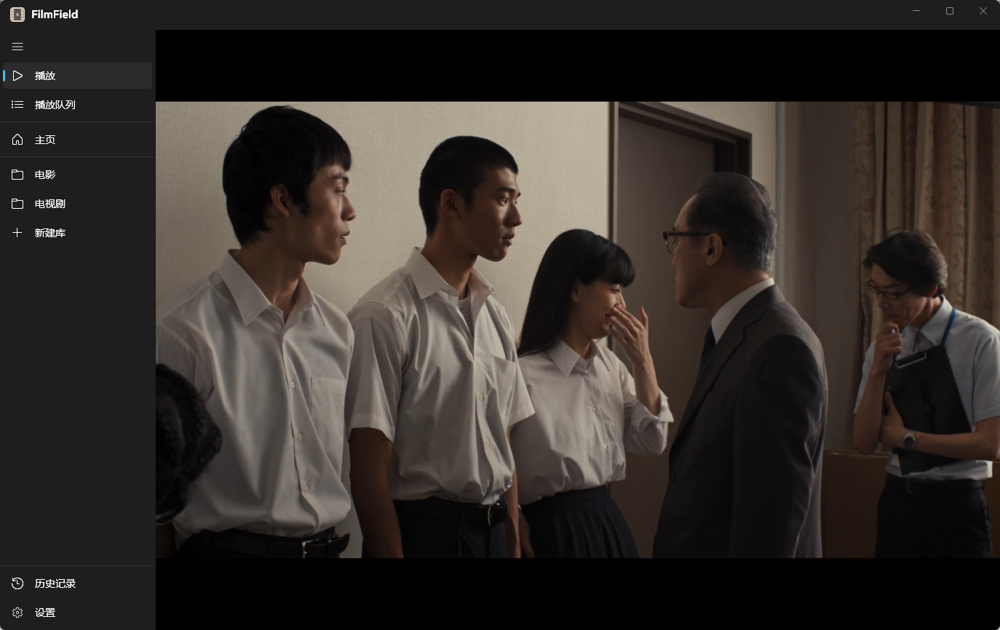
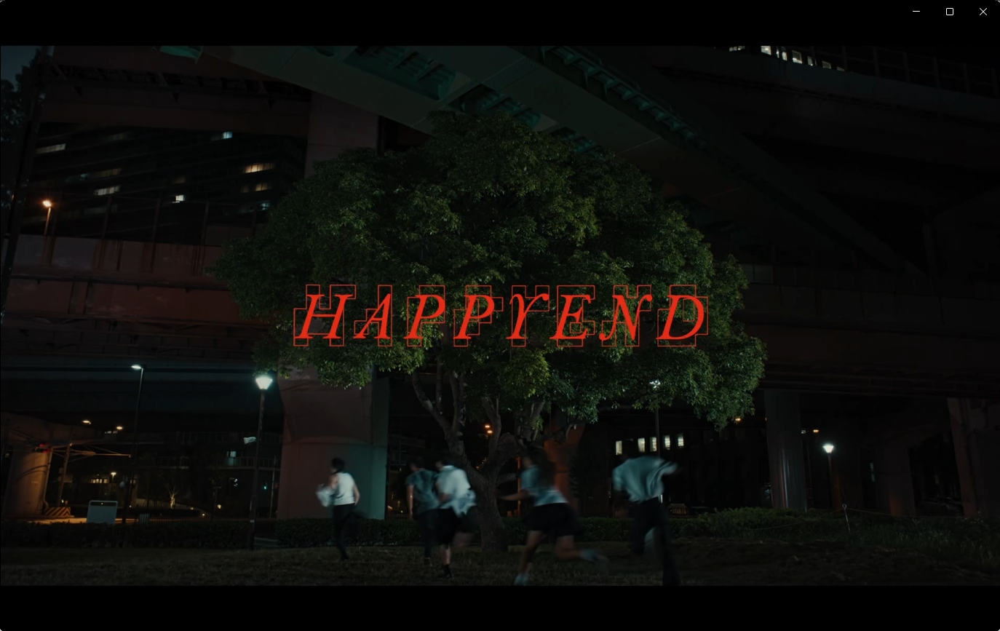
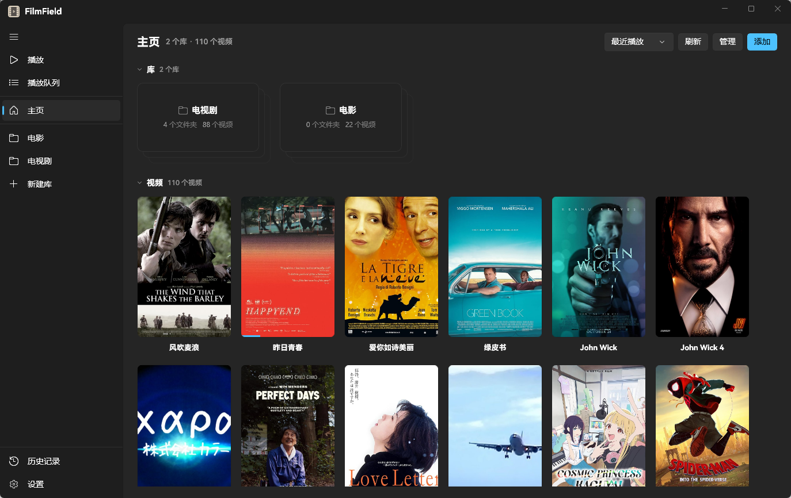
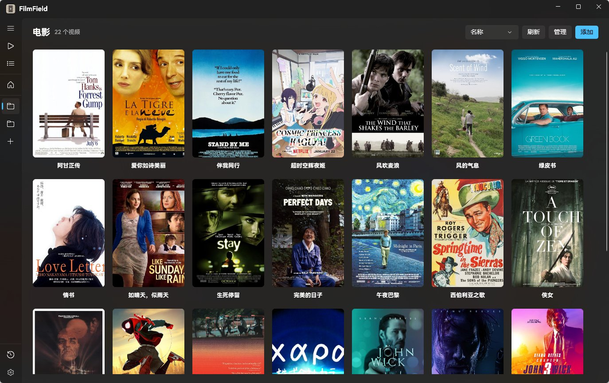
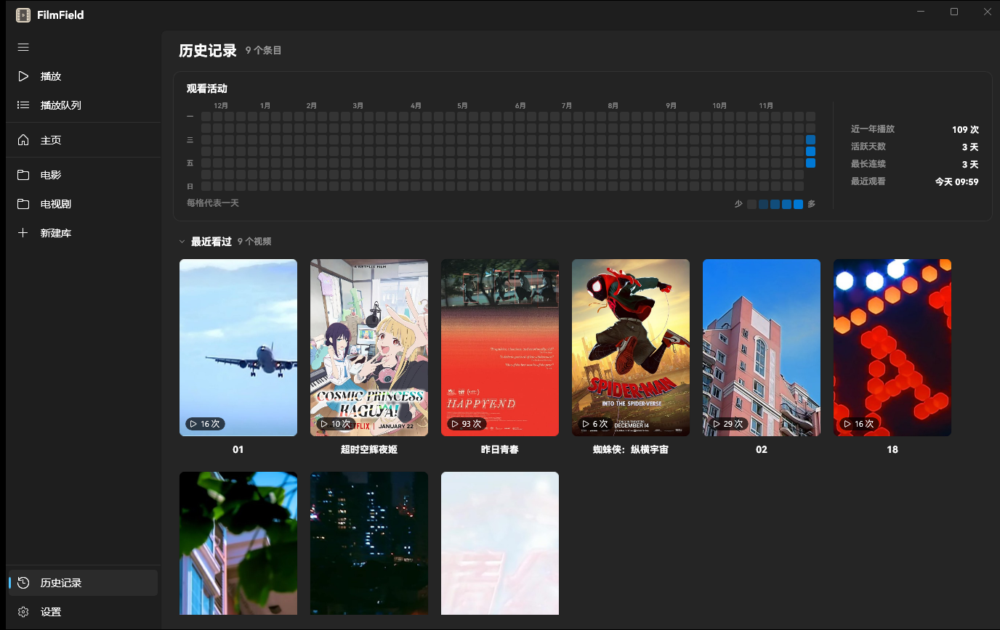

# FilmField

简体中文 | [English](docs/README.en.md) | [繁體中文](docs/README.zh-TW.md) | [日本語](docs/README.ja.md) | [한국어](docs/README.ko.md) | [Русский](docs/README.ru.md) | [Español](docs/README.es.md) | [Italiano](docs/README.it.md) | [Português](docs/README.pt.md) | [Deutsch](docs/README.de.md) | [Français](docs/README.fr.md) | [Türkçe](docs/README.tr.md) | [Lingua Latina](docs/README.la.md)

你的私人影院。

FilmField 是一款现代化的本地视频播放器，旨在将你的视频收藏变成一个精美的私人电影库。
通过直观的电影海报墙浏览视频，轻松管理本地媒体文件，并享受流畅的播放体验。一切尽在一处。

界面复刻 Windows 11 自带媒体播放器的 Fluent 设计风格，轻量、快速、原生观感。它基于 WinUI 3 与 FFmpeg 构建，支持 Windows 10（1809）及以上版本。

播放内核由 [FFmpegInteropX](https://github.com/ffmpeginteropx/FFmpegInteropX) 驱动，经由系统 Media Foundation 硬件解码，低占用播放主流格式的视频与音频。

## 截图

  

  

  

  

  

一些值得一提的功能：

- Fluent Design 界面，复刻 Windows 11 媒体播放器风格
- FFmpeg 内核 + 系统硬解，广泛覆盖视频与音频格式
- 媒体库管理：文件夹扫描、封面/海报网格、拖拽整理、多库分类
- 联网查找海报（IMDb / TVmaze / Bangumi），支持剧集分季海报与本地图片替换
- 字幕支持：SRT / ASS / SSA / VTT / PGS（蓝光图形字幕），外部字幕自动匹配与记忆
- 进度条缩略图预览：采样帧 + 精确取帧混合方案，悬停即所见
- 一键截图，可叠加字幕保存
- 播放历史：GitHub 式观看热度图与统计面板
- 两种全屏模式：窗口全屏（保留任务栏）与完全全屏
- 云母 / 亚克力背景材质，控制栏毛玻璃
- 长按方向键倍速扫描，快进快退更顺手
- 播放队列、播放位置记忆、开机自启

更多功能还在路上！

## 安装

前往 [Releases](https://github.com/DoYouNatureQ/FilmField/releases) 下载最新版本的压缩包，解压后直接运行 `FilmField.exe` 即可，无需安装。应用为自包含部署，不需要额外安装运行时。

> FilmField 是纯本地播放器，不提供、不内置任何影视片源。

### 从源码构建

1. **环境要求**：Windows 10 1809+，.NET 8 SDK（含 Windows 桌面工作负载），Windows App SDK 1.8
2. **克隆**：`git clone https://github.com/DoYouNatureQ/FilmField.git`
3. **构建**：`dotnet build -p:Platform=x64`
4. **运行**：构建产物输出至 `publish\`，运行 `publish\FilmField.exe`

## 参与贡献

欢迎提交问题反馈、功能建议以及代码贡献。

如果你发现了 Bug，或者有任何改进建议，欢迎通过 Issues 提交反馈，也欢迎提交 Pull Request。

## 致谢

- [FFmpeg](https://ffmpeg.org) — LGPL-2.1+，解码核心
- [FFmpegInteropX](https://github.com/ffmpeginteropx/FFmpegInteropX) — Apache-2.0，FFmpeg 与 Windows 媒体管线的桥接
- [Windows App SDK](https://github.com/microsoft/WindowsAppSDK) — MIT，WinUI 3 应用框架
- [HarmonyOS Sans](https://developer.huawei.com/consumer/cn/design/) — 界面字体
- 海报数据来自 [IMDb](https://www.imdb.com)、[TVmaze](https://www.tvmaze.com)、[Bangumi](https://bgm.tv)

完整的第三方组件版权信息见 [THIRD-PARTY-NOTICES.md](docs/THIRD-PARTY-NOTICES.md)。

## 许可

本项目基于 [GPL-3.0](LICENSE) 许可证开源。
